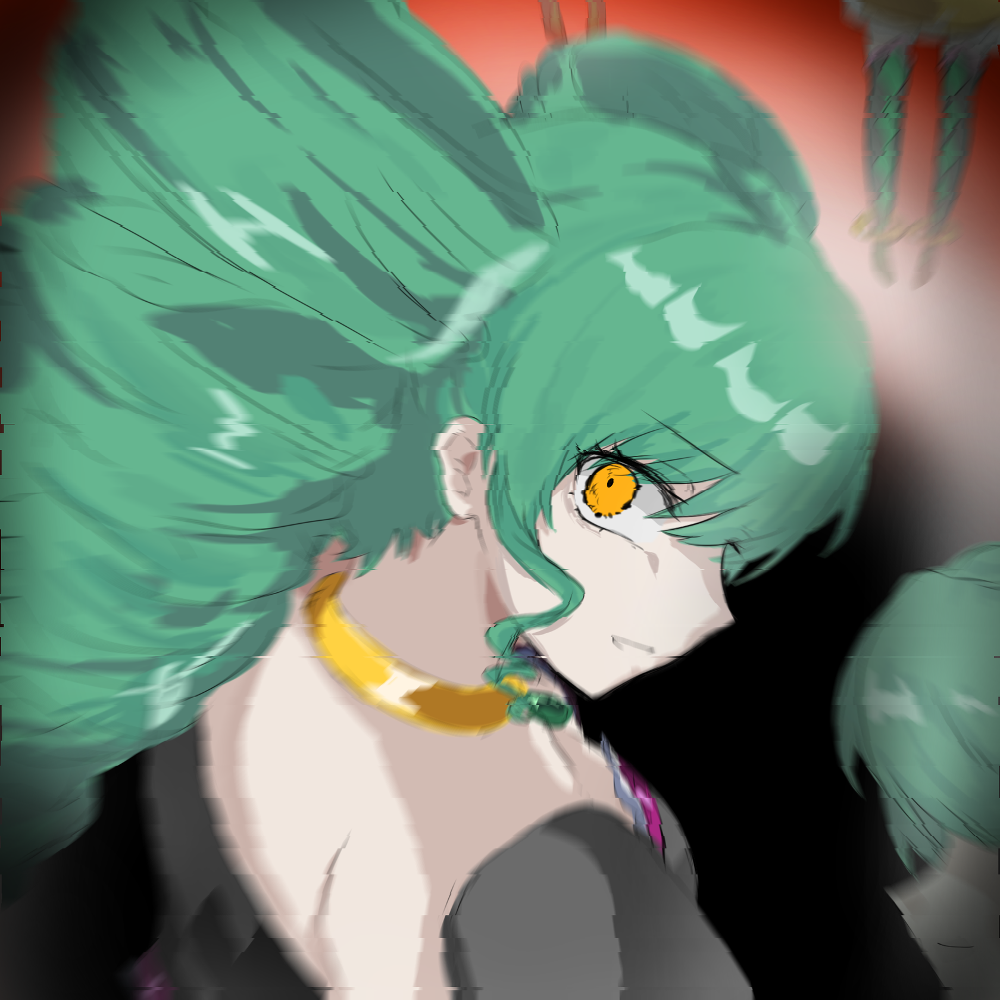

<p align="center">
  
</p>

# Discord Auto Quest

Browser extension (Manifest V3) that automates Discord Quests directly on Discord Web without manual video watching or desktop app workarounds.

> **Credits:** Original concept from [**aamiaa**](https://gist.github.com/aamiaa/204cd9d42013ded9faf646fae7f89fbb) · Maintained & customized by [**wanng**](https://github.com/wanngxuanji/Discord-Auto-Quest)

> [!CAUTION]
> Discord may restrict or suspend quest access on accounts detected automating quest completion. Use at your own risk.

---

## Features

- **Toolbar Popup & In-Page Floating Panel:** Control quests either from the extension icon popup or the floating Shadow DOM widget in the bottom-right corner of `/quest-home`.
- **Two-Way Live Sync:** Both the toolbar popup and in-page panel stay synchronized in real time (`mm:ss`, percentage, and progress bar).
- **Accidental-Stop Protection:** Clicking **Running Quests...** while active opens a confirmation warning (`Keep Running` / `Stop Quests`) instead of stopping immediately.
- **Completion Sound Alert:** Plays `assets/sfx/ting.mp3` once each time an active quest transitions to completed.
- **Supported Quest Types:**
  - `WATCH_VIDEO` & `WATCH_VIDEO_ON_MOBILE`
  - `PLAY_ON_DESKTOP`
  - `STREAM_ON_DESKTOP` *(still requires at least 1 other user in the voice channel)*
  - `PLAY_ACTIVITY`
- **Supported Domains:** `discord.com`, `canary.discord.com`, and `ptb.discord.com`.
- **Privacy-First:** Runs 100% locally in your browser with zero external CDNs or telemetry (see [PRIVACY.md](./PRIVACY.md)).

---

## Project Structure

```text
├── manifest.json
├── README.md
├── PRIVACY.md
├── assets/
│   ├── icon.png
│   └── sfx/
│       └── ting.mp3
├── rules/
│   └── headers.json
└── src/
    ├── background/
    │   └── service-worker.js
    ├── content/
    │   ├── quest-runner.js
    │   ├── quest-ui.js
    │   └── user-agent-override.js
    ├── popup/
    │   ├── popup.css
    │   ├── popup.html
    │   └── popup.js
    └── shared/
        └── quest-shared.js
```

---

## Installation

### Desktop (Chrome / Brave / Edge)
1. Clone or download this repository:
   ```bash
   git clone https://github.com/wanngxuanji/Discord-Auto-Quest.git
   ```
2. Open `chrome://extensions/` (or `brave://extensions/`, `edge://extensions/`).
3. Enable **Developer mode** (top right).
4. Click **Load unpacked** and select the project root folder (`Discord-Auto-Quest`).

### Mobile (Android via Lemur Browser)
1. Download/zip this extension folder.
2. Install **Lemur Browser** from Google Play Store.
3. Open **Extensions** → enable **Developer mode** → load the extension package/folder.
4. Open `https://discord.com/quest-home`, accept a quest, and refresh the page.

---

## How to Use

1. Open **`https://discord.com/quest-home`** (or `canary.discord.com/quest-home` / `ptb.discord.com/quest-home`) in your browser.
2. **Accept** the quests you want to complete.
3. Start automation in either of two ways:
   - Click the **Discord Auto Quest** icon in your browser toolbar (`Open Quest Home` if you're on another tab, or `Run Quests` when on `/quest-home`).
   - Or click the **`Run Quests`** button at the bottom-right of the Discord page (click the arrow button next to it to expand live progress).
4. While running:
   - Each completed quest plays a notification sound (`ting.mp3`).
   - Clicking **`Running Quests...`** opens a confirmation warning so you can choose **Keep Running** or **Stop Quests**.

---

## Troubleshooting

- **Popup says "Reload Needed" or floating button is missing:**
  - Make sure the active tab URL includes `/quest-home` on `discord.com`, `canary.discord.com`, or `ptb.discord.com`.
  - Refresh the page (`F5`) after installing or reloading the extension.
- **Quest stops or shows an error:**
  - Ensure you accepted the quest on Discord first.
  - Check the browser DevTools Console (`F12`) for detailed logs.
  - For `STREAM_ON_DESKTOP` quests, make sure at least one other user is in the voice channel with you.
- **No completion sound:**
  - Check that the browser tab is not muted and that you interacted with the page/popup to start the quests.

---

## Disclaimer

This repository is provided for educational and research purposes only. Automating Discord features may violate Discord's Terms of Service. You are solely responsible for how you use this extension.
